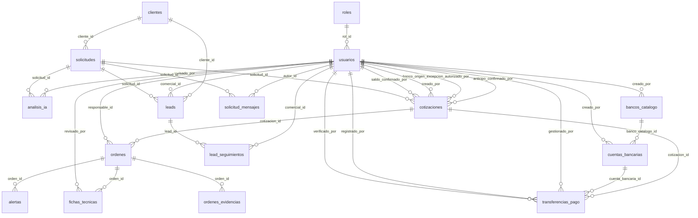

# 03 · Modelo de datos (PostgreSQL)

> **[VERIFICADO]** Generado automáticamente desde la base real con todas las migraciones V0–V18 aplicadas (consulta a `information_schema`, `pg_constraint`, `pg_indexes` y `pg_trigger`). 16 tablas. Sin ORM: acceso con `pg` + SQL directo + patrón Repository.

## Convenciones del modelo
- **PK UUID** en todas las tablas. Los UUID se generan en el backend (`randomUUID()`) o con `gen_random_uuid()`.
- **Estados** = `VARCHAR + CHECK` (no ENUM de PostgreSQL), para poder ampliar con una migración simple.
- **Fechas** `TIMESTAMPTZ`; la única `DATE` pura es la fecha de entrega/requerida.
- **Códigos legibles** (`SOL-/COT-/ORD-######`) los generan **triggers + secuencias** en la BD.
- **Reglas de negocio** (transiciones de estado, permisos, cálculos) viven en el **backend**, no en triggers. La BD solo garantiza integridad (PK/FK/NOT NULL/CHECK/UNIQUE/índices).
- **Migraciones** `backend/database/migrations/V<n>__descripcion.sql`, aditivas, aplicadas en orden numérico.
- **Archivos** (comprobantes, evidencias, logos) **no** se guardan en la BD: solo el nombre; el binario va a `uploads/`.

## Diagrama de relaciones

## Tablas

### `roles`
Catálogo de roles internos (ADMIN, COMERCIAL, OPERATIVO).

| # | Columna | Tipo | Null | Default |
|---|---|---|---|---|
| 1 | `id` | uuid | **no** |  |
| 2 | `nombre` | varchar(50) | **no** |  |
| 3 | `descripcion` | text | sí |  |

**Restricciones**

- PK `roles_pkey`: `PRIMARY KEY (id)`
- UNIQUE `roles_nombre_key`: `UNIQUE (nombre)`

**Índices**

- `roles_nombre_key`: `UNIQUE INDEX roles_nombre_key ON roles (nombre)`

### `usuarios`
Personal interno que inicia sesión. `session_version` invalida sesiones al cambiar la contraseña.

| # | Columna | Tipo | Null | Default |
|---|---|---|---|---|
| 1 | `id` | uuid | **no** |  |
| 2 | `nombre` | varchar(100) | **no** |  |
| 3 | `email` | varchar(150) | **no** |  |
| 4 | `password_hash` | text | **no** |  |
| 5 | `rol_id` | uuid | **no** |  |
| 6 | `activo` | boolean | **no** | `true` |
| 7 | `creado_en` | timestamp with time zone | **no** | `CURRENT_TIMESTAMP` |
| 8 | `session_version` | integer | **no** | `0` |

**Restricciones**

- FK `fk_usuarios_rol`: `FOREIGN KEY (rol_id) REFERENCES roles(id)`
- PK `usuarios_pkey`: `PRIMARY KEY (id)`
- UNIQUE `usuarios_email_key`: `UNIQUE (email)`

**Índices**

- `ix_usuarios_rol_id`: `INDEX ix_usuarios_rol_id ON usuarios (rol_id)`
- `usuarios_email_key`: `UNIQUE INDEX usuarios_email_key ON usuarios (email)`

### `clientes`
Clientes externos (no inician sesión). Se crean/reutilizan por correo al recibir una solicitud.

| # | Columna | Tipo | Null | Default |
|---|---|---|---|---|
| 1 | `id` | uuid | **no** |  |
| 2 | `nombre` | varchar(150) | **no** |  |
| 3 | `empresa` | varchar(150) | sí |  |
| 4 | `email` | varchar(150) | **no** |  |
| 5 | `telefono` | varchar(30) | **no** |  |
| 6 | `creado_en` | timestamp with time zone | **no** | `CURRENT_TIMESTAMP` |

**Restricciones**

- PK `clientes_pkey`: `PRIMARY KEY (id)`

### `solicitudes`
Petición de trabajo/cotización del cliente. Código legible `SOL-000001` (trigger) e `idempotency_key` para evitar duplicados.

| # | Columna | Tipo | Null | Default |
|---|---|---|---|---|
| 1 | `id` | uuid | **no** |  |
| 2 | `cliente_id` | uuid | **no** |  |
| 3 | `servicio` | varchar(150) | **no** |  |
| 4 | `descripcion` | text | **no** |  |
| 5 | `cantidad` | integer | **no** |  |
| 6 | `fecha_requerida` | date | sí |  |
| 7 | `estado` | varchar(20) | **no** | `'NUEVA'::character varying` |
| 8 | `creado_en` | timestamp with time zone | **no** | `CURRENT_TIMESTAMP` |
| 9 | `actualizado_en` | timestamp with time zone | **no** | `CURRENT_TIMESTAMP` |
| 10 | `especificaciones` | text | sí |  |
| 11 | `requiere_comprobante` | boolean | **no** | `false` |
| 12 | `codigo` | varchar(50) | sí |  |
| 13 | `idempotency_key` | varchar(100) | sí |  |

**Restricciones**

- CHECK `chk_solicitudes_estado`: `CHECK (((estado)::text = ANY ((ARRAY['NUEVA'::character varying, 'EN_REVISION'::character varying, 'COTIZADA'::character varying, 'CANCELADA'::character varying])::text[])))`
- CHECK `solicitudes_cantidad_check`: `CHECK ((cantidad > 0))`
- FK `fk_solicitudes_cliente`: `FOREIGN KEY (cliente_id) REFERENCES clientes(id)`
- PK `solicitudes_pkey`: `PRIMARY KEY (id)`
- UNIQUE `uq_solicitudes_codigo`: `UNIQUE (codigo)`
- UNIQUE `uq_solicitudes_idempotency_key`: `UNIQUE (idempotency_key)`

**Índices**

- `ix_solicitudes_cliente_id`: `INDEX ix_solicitudes_cliente_id ON solicitudes (cliente_id)`
- `uq_solicitudes_codigo`: `UNIQUE INDEX uq_solicitudes_codigo ON solicitudes (codigo)`
- `uq_solicitudes_idempotency_key`: `UNIQUE INDEX uq_solicitudes_idempotency_key ON solicitudes (idempotency_key)`

**Triggers**

- `trg_solicitudes_generar_codigo` (BEFORE INSERT → genera el código legible)

### `analisis_ia`
Resultado de cada ejecución del análisis con IA sobre una solicitud (1:N). Requiere revisión humana (`revisado`).

| # | Columna | Tipo | Null | Default |
|---|---|---|---|---|
| 1 | `id` | uuid | **no** |  |
| 2 | `solicitud_id` | uuid | **no** |  |
| 3 | `fecha_hora` | timestamp with time zone | **no** | `CURRENT_TIMESTAMP` |
| 4 | `resultado` | text | sí |  |
| 5 | `prioridad_sugerida` | varchar(10) | sí |  |
| 6 | `informacion_estructurada` | jsonb | sí |  |
| 7 | `modelo_ia` | varchar(100) | sí |  |
| 8 | `version_ia` | varchar(50) | sí |  |
| 9 | `estado` | varchar(15) | **no** | `'PENDIENTE'::character varying` |
| 10 | `revisado` | boolean | **no** | `false` |
| 11 | `revisado_por` | uuid | sí |  |
| 12 | `revisado_en` | timestamp with time zone | sí |  |

**Restricciones**

- CHECK `chk_analisis_ia_estado`: `CHECK (((estado)::text = ANY ((ARRAY['PENDIENTE'::character varying, 'PROCESANDO'::character varying, 'COMPLETADO'::character varying, 'ERROR'::character varying])::text[])))`
- CHECK `chk_analisis_ia_prioridad`: `CHECK (((prioridad_sugerida IS NULL) OR ((prioridad_sugerida)::text = ANY ((ARRAY['ALTA'::character varying, 'MEDIA'::character varying, 'BAJA'::character varying])::text[]))))`
- FK `fk_analisis_ia_revisado_por`: `FOREIGN KEY (revisado_por) REFERENCES usuarios(id) ON DELETE RESTRICT`
- FK `fk_analisis_ia_solicitud`: `FOREIGN KEY (solicitud_id) REFERENCES solicitudes(id)`
- PK `analisis_ia_pkey`: `PRIMARY KEY (id)`

**Índices**

- `ix_analisis_ia_solicitud_id`: `INDEX ix_analisis_ia_solicitud_id ON analisis_ia (solicitud_id)`

### `cotizaciones`
Oferta económica: valor, IVA, anticipo, saldo, vigencia, enlace público con código de acceso. Código `COT-000001` (trigger).

| # | Columna | Tipo | Null | Default |
|---|---|---|---|---|
| 1 | `id` | uuid | **no** |  |
| 2 | `solicitud_id` | uuid | **no** |  |
| 3 | `valor` | numeric(12,2) | **no** |  |
| 4 | `estado` | varchar(15) | **no** | `'BORRADOR'::character varying` |
| 5 | `creado_en` | timestamp with time zone | **no** | `CURRENT_TIMESTAMP` |
| 6 | `descripcion` | text | sí |  |
| 7 | `creado_por` | uuid | sí |  |
| 8 | `subtotal` | numeric(12,2) | sí |  |
| 9 | `iva_porcentaje` | numeric(5,2) | sí |  |
| 10 | `iva_valor` | numeric(12,2) | sí |  |
| 11 | `total` | numeric(12,2) | sí |  |
| 12 | `anticipo_porcentaje` | numeric(5,2) | sí |  |
| 13 | `anticipo_valor` | numeric(12,2) | sí |  |
| 14 | `saldo_pendiente` | numeric(12,2) | sí |  |
| 15 | `metodo_anticipo` | varchar(20) | sí |  |
| 16 | `estado_anticipo` | varchar(20) | sí |  |
| 17 | `comprobante_anticipo` | text | sí |  |
| 18 | `anticipo_confirmado_en` | timestamp with time zone | sí |  |
| 19 | `anticipo_confirmado_por` | uuid | sí |  |
| 20 | `fecha_vigencia` | timestamp with time zone | sí |  |
| 21 | `aceptada_en` | timestamp with time zone | sí |  |
| 22 | `actualizado_en` | timestamp with time zone | sí | `CURRENT_TIMESTAMP` |
| 23 | `acceso_codigo_hash` | varchar(255) | sí |  |
| 24 | `rechazada_en` | timestamp with time zone | sí |  |
| 25 | `metodo_saldo` | varchar(20) | sí |  |
| 26 | `estado_saldo` | varchar(20) | **no** | `'PENDIENTE'::character varying` |
| 27 | `comprobante_saldo` | text | sí |  |
| 28 | `saldo_confirmado_en` | timestamp with time zone | sí |  |
| 29 | `saldo_confirmado_por` | uuid | sí |  |
| 30 | `codigo` | varchar(50) | sí |  |
| 31 | `banco_origen_excepcion_autorizado_por` | uuid | sí |  |
| 32 | `banco_origen_excepcion_autorizado_en` | timestamp with time zone | sí |  |

**Restricciones**

- CHECK `chk_cotizaciones_anticipo_rango`: `CHECK (((anticipo_porcentaje IS NULL) OR ((anticipo_porcentaje >= (0)::numeric) AND (anticipo_porcentaje <= (100)::numeric))))`
- CHECK `chk_cotizaciones_anticipo_valor_no_negativo`: `CHECK (((anticipo_valor IS NULL) OR (anticipo_valor >= (0)::numeric)))`
- CHECK `chk_cotizaciones_estado`: `CHECK (((estado)::text = ANY ((ARRAY['BORRADOR'::character varying, 'ENVIADA'::character varying, 'ACEPTADA'::character varying, 'RECHAZADA'::character varying, 'VENCIDA'::character varying, 'CANCELADA'::character varying])::text[])))`
- CHECK `chk_cotizaciones_estado_anticipo`: `CHECK (((estado_anticipo IS NULL) OR ((estado_anticipo)::text = ANY ((ARRAY['PENDIENTE'::character varying, 'VALIDADO'::character varying, 'RECHAZADO'::character varying, 'NO_APLICA'::character varying])::text[]))))`
- CHECK `chk_cotizaciones_estado_saldo`: `CHECK (((estado_saldo)::text = ANY ((ARRAY['PENDIENTE'::character varying, 'VALIDADO'::character varying, 'RECHAZADO'::character varying])::text[])))`
- CHECK `chk_cotizaciones_iva_rango`: `CHECK (((iva_porcentaje IS NULL) OR ((iva_porcentaje >= (0)::numeric) AND (iva_porcentaje <= (100)::numeric))))`
- CHECK `chk_cotizaciones_iva_valor_no_negativo`: `CHECK (((iva_valor IS NULL) OR (iva_valor >= (0)::numeric)))`
- CHECK `chk_cotizaciones_metodo_anticipo`: `CHECK (((metodo_anticipo IS NULL) OR ((metodo_anticipo)::text = ANY ((ARRAY['TRANSFERENCIA'::character varying, 'EFECTIVO'::character varying])::text[]))))`
- CHECK `chk_cotizaciones_metodo_saldo`: `CHECK (((metodo_saldo IS NULL) OR ((metodo_saldo)::text = ANY ((ARRAY['TRANSFERENCIA'::character varying, 'EFECTIVO'::character varying])::text[]))))`
- CHECK `chk_cotizaciones_saldo_no_negativo`: `CHECK (((saldo_pendiente IS NULL) OR (saldo_pendiente >= (0)::numeric)))`
- CHECK `chk_cotizaciones_subtotal_no_negativo`: `CHECK (((subtotal IS NULL) OR (subtotal >= (0)::numeric)))`
- CHECK `chk_cotizaciones_total_no_negativo`: `CHECK (((total IS NULL) OR (total >= (0)::numeric)))`
- CHECK `cotizaciones_valor_check`: `CHECK ((valor >= (0)::numeric))`
- FK `fk_cotizaciones_anticipo_confirmado_por`: `FOREIGN KEY (anticipo_confirmado_por) REFERENCES usuarios(id) ON DELETE RESTRICT`
- FK `fk_cotizaciones_banco_origen_excepcion_autorizado_por`: `FOREIGN KEY (banco_origen_excepcion_autorizado_por) REFERENCES usuarios(id) ON DELETE RESTRICT`
- FK `fk_cotizaciones_creado_por`: `FOREIGN KEY (creado_por) REFERENCES usuarios(id) ON DELETE RESTRICT`
- FK `fk_cotizaciones_saldo_confirmado_por`: `FOREIGN KEY (saldo_confirmado_por) REFERENCES usuarios(id) ON DELETE RESTRICT`
- FK `fk_cotizaciones_solicitud`: `FOREIGN KEY (solicitud_id) REFERENCES solicitudes(id)`
- PK `cotizaciones_pkey`: `PRIMARY KEY (id)`
- UNIQUE `uq_cotizaciones_codigo`: `UNIQUE (codigo)`

**Índices**

- `ix_cotizaciones_solicitud_id`: `INDEX ix_cotizaciones_solicitud_id ON cotizaciones (solicitud_id)`
- `uq_cotizaciones_codigo`: `UNIQUE INDEX uq_cotizaciones_codigo ON cotizaciones (codigo)`
- `ux_cotizaciones_una_aceptada`: `UNIQUE INDEX ux_cotizaciones_una_aceptada ON cotizaciones (solicitud_id) WHERE ((estado)::text = 'ACEPTADA'::text)`

**Triggers**

- `trg_cotizaciones_generar_codigo` (BEFORE INSERT → genera el código legible)

### `ordenes`
Orden de trabajo creada a partir de una cotización ACEPTADA (1:1). Código `ORD-000001` (trigger). Avance 0–100.

| # | Columna | Tipo | Null | Default |
|---|---|---|---|---|
| 1 | `id` | uuid | **no** |  |
| 2 | `cotizacion_id` | uuid | **no** |  |
| 3 | `responsable_id` | uuid | sí |  |
| 4 | `estado` | varchar(20) | **no** | `'PENDIENTE'::character varying` |
| 5 | `fecha_inicio` | date | sí |  |
| 6 | `fecha_entrega` | date | sí |  |
| 7 | `creado_en` | timestamp with time zone | **no** | `CURRENT_TIMESTAMP` |
| 8 | `actualizado_en` | timestamp with time zone | **no** | `CURRENT_TIMESTAMP` |
| 9 | `codigo` | varchar(50) | **no** |  |
| 10 | `descripcion` | text | sí |  |
| 11 | `fecha_programada` | timestamp with time zone | sí |  |
| 12 | `fecha_finalizacion` | timestamp with time zone | sí |  |
| 13 | `fecha_cierre` | timestamp with time zone | sí |  |
| 14 | `observaciones` | text | sí |  |
| 15 | `avance` | integer | **no** | `0` |
| 16 | `entrega_confirmada_en` | timestamp with time zone | sí |  |

**Restricciones**

- CHECK `chk_ordenes_avance`: `CHECK (((avance >= 0) AND (avance <= 100)))`
- CHECK `chk_ordenes_estado`: `CHECK (((estado)::text = ANY ((ARRAY['PENDIENTE'::character varying, 'EN_PROCESO'::character varying, 'PAUSADA'::character varying, 'FINALIZADA'::character varying, 'CERRADA'::character varying, 'CANCELADA'::character varying])::text[])))`
- CHECK `chk_ordenes_fechas`: `CHECK (((fecha_entrega IS NULL) OR (fecha_inicio IS NULL) OR (fecha_entrega >= fecha_inicio)))`
- FK `fk_ordenes_cotizacion`: `FOREIGN KEY (cotizacion_id) REFERENCES cotizaciones(id)`
- FK `fk_ordenes_responsable`: `FOREIGN KEY (responsable_id) REFERENCES usuarios(id) ON DELETE SET NULL`
- PK `ordenes_pkey`: `PRIMARY KEY (id)`
- UNIQUE `ordenes_cotizacion_id_key`: `UNIQUE (cotizacion_id)`
- UNIQUE `uq_ordenes_codigo`: `UNIQUE (codigo)`

**Índices**

- `ordenes_cotizacion_id_key`: `UNIQUE INDEX ordenes_cotizacion_id_key ON ordenes (cotizacion_id)`
- `uq_ordenes_codigo`: `UNIQUE INDEX uq_ordenes_codigo ON ordenes (codigo)`

**Triggers**

- `trg_ordenes_generar_codigo` (BEFORE INSERT → genera el código legible)

### `alertas`
Avisos sobre órdenes (entrega vencida/próxima, inconsistencia de ficha). Únicas por orden+tipo+condición.

| # | Columna | Tipo | Null | Default |
|---|---|---|---|---|
| 1 | `id` | uuid | **no** |  |
| 2 | `orden_id` | uuid | **no** |  |
| 3 | `tipo` | varchar(50) | **no** |  |
| 4 | `condicion` | varchar(100) | **no** |  |
| 5 | `mensaje` | text | **no** |  |
| 6 | `estado` | varchar(15) | **no** | `'PENDIENTE'::character varying` |
| 7 | `creado_en` | timestamp with time zone | **no** | `CURRENT_TIMESTAMP` |
| 8 | `leida` | boolean | **no** | `false` |
| 9 | `leida_en` | timestamp with time zone | sí |  |

**Restricciones**

- CHECK `chk_alertas_estado`: `CHECK (((estado)::text = ANY ((ARRAY['PENDIENTE'::character varying, 'ENVIADA'::character varying, 'ATENDIDA'::character varying, 'CANCELADA'::character varying])::text[])))`
- FK `fk_alertas_orden`: `FOREIGN KEY (orden_id) REFERENCES ordenes(id)`
- PK `alertas_pkey`: `PRIMARY KEY (id)`

**Índices**

- `ix_alertas_orden_id`: `INDEX ix_alertas_orden_id ON alertas (orden_id)`
- `ux_alertas_orden_tipo_condicion`: `UNIQUE INDEX ux_alertas_orden_tipo_condicion ON alertas (orden_id, tipo, condicion)`

### `fichas_tecnicas`
Ficha técnica generada por IA para una orden (1:1) con bandera de inconsistencias.

| # | Columna | Tipo | Null | Default |
|---|---|---|---|---|
| 1 | `id` | uuid | **no** | `gen_random_uuid()` |
| 2 | `orden_id` | uuid | **no** |  |
| 3 | `contenido` | text | **no** |  |
| 4 | `tiene_inconsistencia` | boolean | **no** | `false` |
| 5 | `generado_en` | timestamp with time zone | **no** | `CURRENT_TIMESTAMP` |
| 6 | `revisado_por` | uuid | sí |  |
| 7 | `revisado_en` | timestamp with time zone | sí |  |

**Restricciones**

- FK `fichas_tecnicas_orden_id_fkey`: `FOREIGN KEY (orden_id) REFERENCES ordenes(id)`
- FK `fichas_tecnicas_revisado_por_fkey`: `FOREIGN KEY (revisado_por) REFERENCES usuarios(id)`
- PK `fichas_tecnicas_pkey`: `PRIMARY KEY (id)`
- UNIQUE `fichas_tecnicas_orden_id_key`: `UNIQUE (orden_id)`

**Índices**

- `fichas_tecnicas_orden_id_key`: `UNIQUE INDEX fichas_tecnicas_orden_id_key ON fichas_tecnicas (orden_id)`

### `ordenes_evidencias`
Archivos (foto/PDF) de evidencia de una orden. El archivo vive en disco; aquí solo el nombre.

| # | Columna | Tipo | Null | Default |
|---|---|---|---|---|
| 1 | `id` | uuid | **no** | `gen_random_uuid()` |
| 2 | `orden_id` | uuid | **no** |  |
| 3 | `tipo` | varchar(4) | **no** |  |
| 4 | `nombre_archivo` | text | **no** |  |
| 5 | `creado_en` | timestamp with time zone | **no** | `CURRENT_TIMESTAMP` |

**Restricciones**

- CHECK `chk_ordenes_evidencias_tipo`: `CHECK (((tipo)::text = ANY ((ARRAY['FOTO'::character varying, 'PDF'::character varying])::text[])))`
- FK `ordenes_evidencias_orden_id_fkey`: `FOREIGN KEY (orden_id) REFERENCES ordenes(id)`
- PK `ordenes_evidencias_pkey`: `PRIMARY KEY (id)`

**Índices**

- `ix_ordenes_evidencias_orden_id`: `INDEX ix_ordenes_evidencias_orden_id ON ordenes_evidencias (orden_id)`

### `solicitud_mensajes`
Chat interno por solicitud entre COMERCIAL y OPERATIVO, con mensajes del asistente IA (NEXIA).

| # | Columna | Tipo | Null | Default |
|---|---|---|---|---|
| 1 | `id` | uuid | **no** | `gen_random_uuid()` |
| 2 | `solicitud_id` | uuid | **no** |  |
| 3 | `autor_id` | uuid | sí |  |
| 4 | `autor_tipo` | varchar(10) | **no** |  |
| 5 | `contenido` | text | **no** |  |
| 6 | `creado_en` | timestamp with time zone | **no** | `CURRENT_TIMESTAMP` |

**Restricciones**

- CHECK `chk_solicitud_mensajes_autor_id`: `CHECK (((((autor_tipo)::text = 'NEXIA'::text) AND (autor_id IS NULL)) OR (((autor_tipo)::text <> 'NEXIA'::text) AND (autor_id IS NOT NULL))))`
- CHECK `chk_solicitud_mensajes_autor_tipo`: `CHECK (((autor_tipo)::text = ANY ((ARRAY['COMERCIAL'::character varying, 'OPERATIVO'::character varying, 'NEXIA'::character varying])::text[])))`
- CHECK `chk_solicitud_mensajes_contenido_no_vacio`: `CHECK ((btrim(contenido) <> ''::text))`
- FK `solicitud_mensajes_autor_id_fkey`: `FOREIGN KEY (autor_id) REFERENCES usuarios(id)`
- FK `solicitud_mensajes_solicitud_id_fkey`: `FOREIGN KEY (solicitud_id) REFERENCES solicitudes(id)`
- PK `solicitud_mensajes_pkey`: `PRIMARY KEY (id)`

**Índices**

- `ix_solicitud_mensajes_solicitud_id`: `INDEX ix_solicitud_mensajes_solicitud_id ON solicitud_mensajes (solicitud_id, creado_en)`

### `leads`
Mini-CRM: prospectos captados antes (o sin) solicitud. Clasificación FRIO→TIBIO→CALIENTE→CONVERTIDO→RECURRENTE.

| # | Columna | Tipo | Null | Default |
|---|---|---|---|---|
| 1 | `id` | uuid | **no** | `gen_random_uuid()` |
| 2 | `nombre` | varchar(150) | **no** |  |
| 3 | `telefono` | varchar(30) | **no** |  |
| 4 | `email` | varchar(150) | sí |  |
| 5 | `fuente` | varchar(20) | **no** |  |
| 6 | `estado` | varchar(20) | **no** | `'ACTIVO'::character varying` |
| 7 | `clasificacion` | varchar(20) | **no** | `'FRIO'::character varying` |
| 8 | `comercial_id` | uuid | sí |  |
| 9 | `cliente_id` | uuid | sí |  |
| 10 | `solicitud_id` | uuid | sí |  |
| 11 | `ultimo_contacto` | timestamp with time zone | sí |  |
| 12 | `proximo_seguimiento` | timestamp with time zone | sí |  |
| 13 | `observaciones` | text | sí |  |
| 14 | `creado_en` | timestamp with time zone | **no** | `CURRENT_TIMESTAMP` |
| 15 | `actualizado_en` | timestamp with time zone | **no** | `CURRENT_TIMESTAMP` |

**Restricciones**

- CHECK `chk_leads_clasificacion`: `CHECK (((clasificacion)::text = ANY ((ARRAY['FRIO'::character varying, 'TIBIO'::character varying, 'CALIENTE'::character varying, 'CONVERTIDO'::character varying, 'RECURRENTE'::character varying])::text[])))`
- CHECK `chk_leads_estado`: `CHECK (((estado)::text = ANY ((ARRAY['ACTIVO'::character varying, 'DESCARTADO'::character varying])::text[])))`
- CHECK `chk_leads_fuente`: `CHECK (((fuente)::text = ANY ((ARRAY['WEB'::character varying, 'WHATSAPP'::character varying, 'FACEBOOK'::character varying, 'INSTAGRAM'::character varying, 'TIKTOK'::character varying, 'REFERIDO'::character varying, 'OTRO'::character varying])::text[])))`
- FK `leads_cliente_id_fkey`: `FOREIGN KEY (cliente_id) REFERENCES clientes(id)`
- FK `leads_comercial_id_fkey`: `FOREIGN KEY (comercial_id) REFERENCES usuarios(id) ON DELETE SET NULL`
- FK `leads_solicitud_id_fkey`: `FOREIGN KEY (solicitud_id) REFERENCES solicitudes(id)`
- PK `leads_pkey`: `PRIMARY KEY (id)`

**Índices**

- `ix_leads_cliente_id`: `INDEX ix_leads_cliente_id ON leads (cliente_id)`
- `ix_leads_comercial_id`: `INDEX ix_leads_comercial_id ON leads (comercial_id)`
- `ix_leads_solicitud_id`: `INDEX ix_leads_solicitud_id ON leads (solicitud_id)`

### `lead_seguimientos`
Bitácora de contactos con un lead (llamada, WhatsApp, correo, visita).

| # | Columna | Tipo | Null | Default |
|---|---|---|---|---|
| 1 | `id` | uuid | **no** | `gen_random_uuid()` |
| 2 | `lead_id` | uuid | **no** |  |
| 3 | `comercial_id` | uuid | sí |  |
| 4 | `tipo` | varchar(20) | **no** |  |
| 5 | `observacion` | text | sí |  |
| 6 | `fecha` | timestamp with time zone | **no** | `CURRENT_TIMESTAMP` |

**Restricciones**

- CHECK `chk_lead_seguimientos_tipo`: `CHECK (((tipo)::text = ANY ((ARRAY['LLAMADA'::character varying, 'WHATSAPP'::character varying, 'EMAIL'::character varying, 'VISITA'::character varying, 'OTRO'::character varying])::text[])))`
- FK `lead_seguimientos_comercial_id_fkey`: `FOREIGN KEY (comercial_id) REFERENCES usuarios(id) ON DELETE SET NULL`
- FK `lead_seguimientos_lead_id_fkey`: `FOREIGN KEY (lead_id) REFERENCES leads(id)`
- PK `lead_seguimientos_pkey`: `PRIMARY KEY (id)`

**Índices**

- `ix_lead_seguimientos_lead_id`: `INDEX ix_lead_seguimientos_lead_id ON lead_seguimientos (lead_id)`

### `bancos_catalogo`
Catálogo de entidades financieras (BANCO/COOPERATIVA) con logo opcional.

| # | Columna | Tipo | Null | Default |
|---|---|---|---|---|
| 1 | `id` | uuid | **no** |  |
| 2 | `nombre` | varchar(150) | **no** |  |
| 3 | `nombre_normalizado` | varchar(150) | **no** |  |
| 4 | `logo_path` | text | sí |  |
| 5 | `creado_por` | uuid | **no** |  |
| 6 | `creado_en` | timestamp with time zone | **no** | `CURRENT_TIMESTAMP` |
| 7 | `tipo` | varchar(20) | **no** | `'BANCO'::character varying` |

**Restricciones**

- CHECK `chk_bancos_catalogo_tipo`: `CHECK (((tipo)::text = ANY ((ARRAY['BANCO'::character varying, 'COOPERATIVA'::character varying])::text[])))`
- FK `fk_bancos_catalogo_creado_por`: `FOREIGN KEY (creado_por) REFERENCES usuarios(id) ON DELETE RESTRICT`
- PK `bancos_catalogo_pkey`: `PRIMARY KEY (id)`
- UNIQUE `ux_bancos_catalogo_nombre_normalizado`: `UNIQUE (nombre_normalizado)`

**Índices**

- `ux_bancos_catalogo_nombre_normalizado`: `UNIQUE INDEX ux_bancos_catalogo_nombre_normalizado ON bancos_catalogo (nombre_normalizado)`

### `cuentas_bancarias`
Cuentas de la empresa que RECIBEN pagos (administradas por ADMIN).

| # | Columna | Tipo | Null | Default |
|---|---|---|---|---|
| 1 | `id` | uuid | **no** |  |
| 2 | `banco` | varchar(100) | **no** |  |
| 3 | `titular` | varchar(200) | **no** |  |
| 4 | `tipo_cuenta` | varchar(20) | **no** |  |
| 5 | `numero_cuenta` | varchar(50) | **no** |  |
| 6 | `activo` | boolean | **no** | `true` |
| 7 | `creado_por` | uuid | **no** |  |
| 8 | `creado_en` | timestamp with time zone | **no** | `CURRENT_TIMESTAMP` |
| 9 | `actualizado_en` | timestamp with time zone | **no** | `CURRENT_TIMESTAMP` |
| 10 | `banco_catalogo_id` | uuid | sí |  |
| 11 | `titular_visible_cliente` | boolean | **no** | `true` |
| 12 | `logo_path` | text | sí |  |

**Restricciones**

- CHECK `chk_cuentas_bancarias_tipo_cuenta`: `CHECK (((tipo_cuenta)::text = ANY ((ARRAY['AHORROS'::character varying, 'CORRIENTE'::character varying])::text[])))`
- FK `fk_cuentas_bancarias_banco_catalogo`: `FOREIGN KEY (banco_catalogo_id) REFERENCES bancos_catalogo(id) ON DELETE RESTRICT`
- FK `fk_cuentas_bancarias_creado_por`: `FOREIGN KEY (creado_por) REFERENCES usuarios(id) ON DELETE RESTRICT`
- PK `cuentas_bancarias_pkey`: `PRIMARY KEY (id)`

### `transferencias_pago`
Historial de pagos por transferencia (ANTICIPO/SALDO) con comprobante, estado y snapshot de la cuenta receptora. Un solo registro vigente por cotización+tipo.

| # | Columna | Tipo | Null | Default |
|---|---|---|---|---|
| 1 | `id` | uuid | **no** |  |
| 2 | `cotizacion_id` | uuid | **no** |  |
| 3 | `tipo_pago` | varchar(10) | **no** |  |
| 4 | `importe_declarado` | numeric(12,2) | **no** |  |
| 5 | `comprobante_path` | text | sí |  |
| 6 | `estado` | varchar(20) | **no** | `'PENDIENTE'::character varying` |
| 7 | `gestionado_por` | uuid | **no** |  |
| 8 | `verificado_por` | uuid | sí |  |
| 9 | `registrado_por` | uuid | **no** |  |
| 10 | `medio_confirmacion` | varchar(20) | sí |  |
| 11 | `vigente` | boolean | **no** | `true` |
| 12 | `creado_en` | timestamp with time zone | **no** | `CURRENT_TIMESTAMP` |
| 13 | `banco_origen` | varchar(100) | sí |  |
| 14 | `cuenta_bancaria_id` | uuid | sí |  |
| 15 | `banco_cuenta_snapshot` | varchar(100) | sí |  |
| 16 | `titular_cuenta_snapshot` | varchar(200) | sí |  |
| 17 | `tipo_cuenta_snapshot` | varchar(20) | sí |  |
| 18 | `numero_cuenta_snapshot` | varchar(50) | sí |  |
| 19 | `referencia_bancaria` | varchar(100) | sí |  |
| 20 | `motivo_rechazo` | varchar(30) | sí |  |
| 21 | `motivo_rechazo_detalle` | text | sí |  |

**Restricciones**

- CHECK `chk_transferencias_pago_estado`: `CHECK (((estado)::text = ANY ((ARRAY['PENDIENTE'::character varying, 'VALIDADO'::character varying, 'RECHAZADO'::character varying])::text[])))`
- CHECK `chk_transferencias_pago_importe_no_negativo`: `CHECK ((importe_declarado >= (0)::numeric))`
- CHECK `chk_transferencias_pago_medio_confirmacion`: `CHECK (((medio_confirmacion IS NULL) OR ((medio_confirmacion)::text = ANY ((ARRAY['DIRECTO'::character varying, 'TELEFONICO'::character varying])::text[]))))`
- CHECK `chk_transferencias_pago_motivo_rechazo`: `CHECK (((motivo_rechazo IS NULL) OR ((motivo_rechazo)::text = ANY ((ARRAY['COMPROBANTE_INCORRECTO'::character varying, 'IMPORTE_INCORRECTO'::character varying, 'COMPROBANTE_ILEGIBLE'::character varying, 'OTRO'::character varying])::text[]))))`
- CHECK `chk_transferencias_pago_tipo_pago`: `CHECK (((tipo_pago)::text = ANY ((ARRAY['ANTICIPO'::character varying, 'SALDO'::character varying])::text[])))`
- FK `fk_transferencias_pago_cotizacion`: `FOREIGN KEY (cotizacion_id) REFERENCES cotizaciones(id)`
- FK `fk_transferencias_pago_cuenta_bancaria`: `FOREIGN KEY (cuenta_bancaria_id) REFERENCES cuentas_bancarias(id) ON DELETE RESTRICT`
- FK `fk_transferencias_pago_gestionado_por`: `FOREIGN KEY (gestionado_por) REFERENCES usuarios(id) ON DELETE RESTRICT`
- FK `fk_transferencias_pago_registrado_por`: `FOREIGN KEY (registrado_por) REFERENCES usuarios(id) ON DELETE RESTRICT`
- FK `fk_transferencias_pago_verificado_por`: `FOREIGN KEY (verificado_por) REFERENCES usuarios(id) ON DELETE RESTRICT`
- PK `transferencias_pago_pkey`: `PRIMARY KEY (id)`

**Índices**

- `ux_transferencias_pago_vigente`: `UNIQUE INDEX ux_transferencias_pago_vigente ON transferencias_pago (cotizacion_id, tipo_pago) WHERE (vigente = true)`

